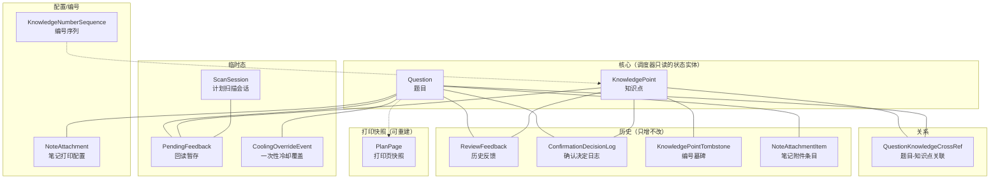

# 架构总览（数据结构）

> 口径：本文件按 `docs/specs/` 的规范口径编写。截至 2026-11-17，`core:model` 已落地调度 DTO（C-053）与 `KnowledgeRowsCodec`（阶段 3.1，C-070），`core:scheduler` 已覆盖 S-01～S-22，`core:pagination` 已覆盖 P-01～P-20 与验收门禁（`INVALID_TEMPLATE_GEOMETRY`、`PLAN_TOO_LONG`、P-20 非法计数；进度见 `docs/conflicts.md` C-032），`data:room` 已落地 Entity↔DTO 映射（阶段 3.2）、10 个 Room 实体、schema v2（含 `NoteAttachmentItem` 与 v1→v2 迁移）、DAO、唯一索引迁移守卫（阶段 4.1）、`savePlan`/`saveDecisions` 单事务 Repository（阶段 4.2）与 `ApplyFeedbackUseCase` 的 U-01～U-19（阶段 4.3a/4.3b/4.3c；接口按 C-075 方案 A：读端口 + 单事务提交入口，结果携带 `SaveDecisionsResult`）；4.3b 已落地冷启动 1/3/7、第 3 条触发反馈后的 DHP 初始化与 `effectiveFeedbackCountBefore >= 3.0f` 的切换边界（C-018/C-037）；4.3c 已落地同 session 多行（含同批同一知识点多次触发的事件序号累计）、晚复习按实际复习日锚定、全 `NOT_REVIEWED` 不进入冷却，并用事务失败用例锁定整体回滚与待确认行保留；U-14 的冷却顺延不另设独立用例，由 `savePlan` 在计划保存的同一事务内写入（C-076 方案 A）；4.4 收尾已完成 U-01～U-19 与 C-050 的逐条复验，并补齐 U-05 的“非触发行 + 本次未复习”场景；审计发现的 C-077～C-089 已于 2026-11-17 裁决并落地（跳过题目状态不落库、跳过行写日志、UseCase 前置校验/重复提交拒绝/周起始口径/迁移锚点；`data:room` 现为 debug/release 各 60 个测试）；2026-11-18 落地阶段 5.1 的 `:app` 壳：手写 `AppContainer`（装配现有 Repository、`ApplyFeedbackUseCase`、`DefaultScheduler`、`DefaultPagePlanner`）、`AppNavigator`（`mutableStateListOf` 快照状态返回栈 + `BackHandler`）、Compose 路由占位与 `MainActivity`，导航返回栈有 2 个 JUnit 5 用例；2026-11-18 修复返回栈未订阅快照状态导致二级页面按返回直接结束 Activity（改为整栈快照状态并在 `AppRoot` 顶层读取 `current`/`canPop`，实体机已验证 Home→Entry 与 Print→PlanPreview→Home 逐级返回）；2026-11-18 落地阶段 5.2 首个纵切：新增 `:feature:entry`（Entry 空态、1 题 1 知识点录入、`EntryViewModel`）与 `:feature:planning`（`GeneratePlanUseCase`、`PlanPreviewViewModel`、预览页），`core:common` 补 `UiState`/`UiError`/`PlanIdGenerator`/`KnowledgeTextMeasurer`，`data:room` 补录入事务与计划读端口；C-047/C-060/C-061/C-062/C-064/C-065/C-066/C-067 有 JUnit 5 用例锁定，计划生成返回类型差异已按 C-090 方案 A 裁决并回写 `planning.md`（`PlanGenerationOutcome`：成功含 `PrintJob` 与预览投影，空计划含空态与提示）；`:app` 已串起 Home → Entry → PlanPreview，并已于 2026-11-18 在实体机 VKJ-AN00（`AXRBUT6518000086`）完成 5.3 验收：Entry 空态 → 1 题 1 知识点 → PlanPreview 1 页 1 条，并验证 C-060 空计划文案，证据见 `evidence/screens/`；同日落地阶段 6.1 打印布局：新增 `:feature:print`（`PrintLayout`/`PrintRenderer`/`PrintPdfWriter`/`RecollectPrintDocumentAdapter`，`KnowledgeTextMeasurer` 实现迁入），只消费 `PrintJob`/`PlacedItem` 输出 A4 PDF，日期标题绘制在上边距内（2026-11-22 起删除每日题数与图例）；PDF 与 300 DPI PNG 证据见 `evidence/print/`；2026-11-18 修正表头错位：表头拆为按列定位的 `headerCells`，知识点列与左侧名称文本左对齐、A/B/C 与三个填涂格同列（`evidence/print/recollect-print-K7M2Q9-page-*.png`）；同日按用户要求把「本日共需复习 X 题」的字号改为与图例一致（3.2mm），行高与 top 不变以保持与日期大标题的间距（该标签与图例已于 2026-11-22 按用户要求删除）；渲染图暴露四角 ArUco 与内容区重叠，C-091 已按方案 A 裁决并落地：`TemplateGeometry.a4Print()` 为四角标记预留 14mm 角区，内容区从 26mm 开始，分页与打印已按新几何重跑，规格已授权回写（print-template/pagination/scan-pipeline/planning）；同日阶段 6.2 完成 OpenScanVision 1.0.0 回读 spike：真机把 2480×3508 渲染页喂给库，原始输出为 ArUco 未检测到 / `LowConfidence(0.0)`；库模板写死（850×540 横向、单 QR、自定义模板不可达），已按 C-092 方案 C 裁决转为自研引擎。2026-11-18 落地阶段 6.3 的引擎部分：新增 `:feature:scan`（`QrPayloadCodec` 载荷/CRC/字符集/页码归属校验、`OmrClassifier` 30%/10% 阈值与行状态、`OpenCvScanEngine` 的 `DICT_4X4_50` 定位 + A4 透视 + ML Kit 逐题 QR + 2.5mm 窗口自采样）；`:feature:print` 四角改为真实 ArUco 图案（`ArucoPattern`，纯 Kotlin 常量）；设备用例断言四角坐标、`rotation=0`、2480×3508、未涂页 3 行全 `NO_MARK`、缺 QR 抛 `QR_NOT_FOUND`，证据见 `evidence/scan/`。归属校验（`ScanOwnershipValidator`）与会话合并（`ScanSessionAccumulator`）已有纯逻辑；2026-11-18 起 `data:room` 的 `ScanSessionRepository` 提供 `pageFacts` 与 `appendPage`（单事务写 `PendingFeedback`、默认 `UNMARKED`），并在 `AppContainer` 装配。2026-11-18 起再落地 `ScanPageUseCase`（引擎 → 归属校验 → `appendPage`，失败零写入）、ML Kit 中文笔记 OCR（只裁书写区）与会话状态（READY、`lateBatch`、`pageIsFuture`、24h 过期清理）。`QR_MULTIPLE`/`QR_UNREADABLE` 设备用例、16KB 对齐与真实打印稿 R-01 仍未完成。C-093 方案 A 已落地：`PlanPage` 增加 `itemGeometry` JSON 快照（schema v3 + 迁移），由 `core:pagination` 的 `ScanGeometryProjection` 在计划生成时冻结，`ScanPageUseCase` 只读快照。字段产权仍须在 Repository/DAO 落地后做完整代码级核对，已落地模块须按代码复核。2026-11-18 落地阶段 6.4 确认页：新增 `:feature:confirm`（纯 Kotlin `ConfirmStateMachine` + JUnit 5 测试 + Compose），逐行标记接受/修改复习效果/本次未复习，存在未标记行时提交按钮禁用；`NOT_REVIEWED` 以空复习日只写决定日志，提交仍由 `ApplyFeedbackUseCase` 复核（C-079）、已提交会话拒绝重复提交（C-080）。实体机 `AXRBUT6518000086` 完成四类决策提交并核对数据库：3 条反馈、4 条决定日志、未复习知识点状态不变；证据见 `evidence/screens/confirm-*`。逐行复习日覆盖、冷却覆盖事件、保存为笔记附件与渲染前完整归属复校验尚未接入确认页。2026-11-18 追加接入打印计划页：`PlanPreview` 保留同一份 `PrintJob`，打印页只从 `PlanPreview` 进入（2026-11-21：Home 删除“打印计划”按钮，生成与打印合并为一条流程；`PlanPreviewViewModel` 提升到 `AppRoot` 顶层，从打印页返回预览页不重新生成计划、计划号不变），由 `AndroidPrintLauncher` 调起系统打印；打印文档写出成功后通过 `PrintSnapshotWriter` 回写 `Question.pageId/qrPayload`（C-033 方案一），实体机已完成 A4 2 页打印预览与“保存为 PDF”，证据见 `evidence/screens/print-*`；快照以文档生成成功为成功点，`PrintPlanSession` 仅内存保存。2026-11-18 新增题目来源页码 `Question.sourcePage`（录入必填，定位试卷/作业本的面，不是打印稿 pageId），schema v4（v3→v4 迁移，旧题为空字符串并显示「未填写」），Entry 表单与列表已接入。同日打印稿「页码」改为只显示页序（不再带计划号）并展示来源页码，确认页逐行展示来源页码；QR 载荷仍为完整 pageId。2026-11-24 用户要求删除题目右上第一行的「页码 XX」；2026-11-25 用户要求把该行改为与计划预览一致的「来源 第X页 第Y题」（X 为页码编号、Y 为题号；没有来源说明时显示「编号X」），QR 载荷与页脚小字 pageId 不变。C-094 方案 B 已落地：文档生成后 App 内确认「已打印/未打印」，确认后才写快照；C-095 方案 B 已落地：页脚 QR 下方以 2.2mm 小字右对齐显示完整 pageId，间距 2mm（标签高度的一半；2026-11-21 用户要求；QR 模块铺满 18mm 框）。2026-11-20 来源页码改为「编号 + 可选说明」：`Question.sourcePageCode` 由用户在「页码编号」控件内通过 +/− 调整（最小 1，默认沿用最近一次使用值、保存后不自增，同一页可复用），`Question.sourcePage` 仅保存用户说明；展示/打印拼接为 `编号-说明`（说明为空时只有编号）。schema v6 为旧行按创建时间补 1..N 编号；v7 取消编号唯一索引以支持同页多题共用。题库卡片支持编辑（铅笔进入独立编辑页面、覆盖保存）与删除（归档，D-11：退出调度、保留历史反馈）；更新在事务内替换关联并重算标签活跃计数。2026-11-20 落地知识点标签库：知识点不再以自由文本录入，题目从标签库选择 1～4 个标签；标签库支持新增/重命名/删除（2026-11-24 用户要求删去搜索框），删除前校验未被未归档题目引用并写编号墓碑；新增 `KnowledgePointTombstone` 与 `KnowledgeNumberSequence` 两个实体（schema v5，v4→v5 迁移按现有最大编号种子序列），编号只增不减、删除后不复用（D-12 / C-028）；新建/编辑使用独立页面（`QuestionEditScreen`，由悬浮按钮或卡片铅笔进入），题目列表占满页面；保存成功先以带对勾 Toast 提示「保存成功」，从首页「录入题目」进入时替换当前页强制跳到题库页（返回键回到首页），从题库页进入时关闭当前页返回题库（2026-11-24 用户要求）。2026-11-20 落地扫描回读页：`AppRoute.Scan` 渲染 `:feature:scan` 的 `ScanScreen`/`ScanViewModel`，Home 提供入口；取图按 C-096 方案 B 使用 CameraX 1.7.0 页内预览（A4 `210:297` 比例、`COMPATIBLE`/TextureView）与 `ImageCapture`，`CAMERA` 权限仅扫描页使用，拒绝时回退相册选图，照片只写 app 缓存并在读取后删除；识别结果只写 `PendingFeedback`；QR 类失败开放手动输入 `pageId + 题号`（`ScanManualCodec` 规范化、`ScanManualEntryUseCase` 写 `UNREADABLE` 行），`PAGE_*`/归属失败只提示重拍或重新打印；重复页、`LATE_BATCH` 与未来日期在页面提示；`ScanSessionRepository.activeSession()` 用于进程重建后恢复最近一次未提交会话，成功后进入确认页。实体机已验证权限、A4 取景、拍摄、相册选图、`PAGE_NOT_FOUND`/`QR_NOT_FOUND`、手动补录与确认提交；R-01 仍需真实打印稿的纸张照片，渲染图不能代替。2026-11-22 落地 C-097：schema v8 新增 `plan` 计划头（周窗口、状态、printedAt、supersededBy、冻结 `renderMeta`）；`PlanSession.open` 复用本周 GENERATED/PRINTED 计划并重建同一 `PrintJob`，显式 `regenerate` 才生成新计划号并把旧计划标为 SUPERSEDED；`savePlan` 同事务写计划头/页面/调度字段；`savePrintSnapshots` 只允许当前计划写题目打印快照并标记 PRINTED。首页按钮按计划状态显示“生成本周计划/查看并打印本周计划”，PlanPreview 增加二次确认的“重新生成本周计划”。2026-11-22 题库页新增搜索：可按题号、来源页码（`编号-说明`）或任一关联知识点名称过滤未归档题目，关键词大小写不敏感、空查询显示全部；搜索条件存放在 `EntryViewModel`，进入编辑页再返回不丢失；`entry.md`/`app.md` 已回写（2026-11-22 用户授权）。2026-11-22 新增复习进度页：`:feature:progress` 通过只读端口 `ReviewProgressRepository` 聚合未归档题目与关联知识点状态（档位、连续掌握度、有效反馈、半衰期、下次到期日），展示题目总数/逾期/今天/7 天内统计、未来 14 天到期分布与逐题掌握度/到期日；首页「快捷操作」为两行 2×2 卡片：第一行「录入题目 / 管理题库」，第二行「扫描回读 / 查看复习进度」，路由分别为 `AppRoute.QuestionEdit(null, fromHome = true)`（2026-11-24 起保存后强制进入题库页）、`AppRoute.Entry`、`AppRoute.Scan`、`AppRoute.Progress`；页面只读，不改变调度与反馈写入（D-01、D-11）。2026-11-24 用户要求删除首页的「管理知识点」「管理题目来源」入口（`AppRoute.KnowledgePoints`/`AppRoute.SourceTags` 路由与页面保留，知识点仍在录入页内以全屏窗口管理），并把其余四个快捷卡片高度由 56dp 增至 72dp。`docs/specs/app.md` 的屏幕清单、模块图与路由已按 2026-11-22 用户授权回写。2026-11-22 填涂格改为答题卡式 16:9 宽格（5.7×3.2mm）：`TemplateGeometry` 统一列几何（序号 6mm、知识点 34mm、列间距 1.5mm、框间距 3.1mm、左侧占比 0.42、采样窗 2.5mm），打印与扫描共用同一组 `bubbleCenterXMm`；项目未发布，不做旧模板/旧稿适配。同日按用户要求删除 PDF 图例与「本日共需复习 X 题」，表头改为「掌握 / 较熟悉 / 不会」并与三框中心对齐；确认页卡片直接显示复习效果识别结果，只保留一个默认填入 OCR 原文的可编辑文本框。OMR 仍只采样中心 2.5mm 窗口，单框阈值不变；行判定改为唯一明确命中优先（恰好 1 个 >30% 命中即判该档，其余框的 10%–30% 模糊读数不推翻它），修复低分辨率扫描把整行误判为 `UNREADABLE`；`print-template.md`、`scan-pipeline.md`、`pagination.md`、`confirm-flow.md` 与 `repository.md` 已按 2026-11-22 用户授权回写。2026-11-22 首页改为仪表盘式布局：顶部本周计划主卡（周窗口、状态与唯一的生成/打印主操作），其下为题目/知识点/已逾期/7 天内概览（读取失败显示“—”，不阻塞入口），再下为 2×2 快捷操作卡片（录入题目 / 查看复习进度 / 扫描回读 / 管理知识点），每张卡片含语义化矢量图标与一句说明；`docs/specs/app.md` 的 Home 行已同步。2026-11-23 C-098：首页主卡改为“本周 + 下周”双区块，`feature:planning` 的 `currentWeekSettings` 取今天所在自然周（不再用“下一个周一”），`nextWeekSettings` 紧随其后；只允许这两个窗口，首页同时查询两个窗口的计划状态，已存在的计划按窗口复用，不会顺延到更远的周。2026-11-23 C-099：`RoomFeedbackRepository.saveDecisions` 在确认日志与待确认行的同一事务内判定计划完成——`plan_page` 的全部页都出现在 `confirmation_decision_log` 且无整题跳过时迁移为 COMPLETED；`activeForWeek` 包含 COMPLETED，重印不降级；2026-11-23 C-100：首页在本周计划 COMPLETED 时交换计划卡主次——下周计划升为主区块（大标题、状态说明、通栏“生成/预览并打印下周计划”），本周降为次要行（“已完成”按钮仍可预览/重印）；其余状态保持本周为主，不按日期/周末判断。2026-11-22 新增来源标签库（schema v9 `source_tag`）：录入/编辑页的「来源（可空）」改为与知识点一样的单选标签，来源标签在录入页内以全屏窗口增删改查；题目仍只保存 `sourcePage` 名称，重命名在事务内同步引用、删除前校验未被未归档题目引用，迁移把旧自由文本来源去重种入标签库。同日页码编号改为「选中来源可键盘输入、无来源沿用 +/−」，默认值按有无来源分别记忆（无来源取最近一条无来源题目，有来源取最近一条有来源题目）。同日录入页的「管理知识点」改为与「管理来源」一致的全屏窗口（左上角关闭叉）：不离开录入页，关闭后只刷新知识点候选并保留未保存的表单内容；首页进入的独立「知识点」页保持不变。同日题库卡片在「知识点」下方增加「预估复习时长：X分钟」，数据取自 `EntrySummary.estimatedReviewMinutes`；2026-11-25 用户要求把卡片大标题改为两行——「来源」（无来源说明时为「编号X」）与「第X页 第Y题」，并把耗时标签与知识点标签并排。同日确认页取消「修正」与「补填」的区分，统一为「修改复习效果」；`isSupplemental` 退出 `ConfirmedDecision`、三张反馈相关表与 `ReviewFeedback`/`ConfirmationDecisionLog`/`PendingFeedback` 实体（schema v10 迁移把历史 `SUPPLEMENTED` 归并为 `CORRECTED`）。同日确认页单行完成决策后，在按钮行最右侧（与校对文本框右缘对齐）显示对勾，并禁用文本框与该行全部按钮；标记「本次未复习」后复习效果标签改为「复习效果：本次未复习」。2026-11-22 新增「导出并分享数据库」页：`:feature:backup` + `data:room` 的 `BackupDao` 与 `RoomDatabaseExporter`（纯 Kotlin JSON writer，未引入 JSON 依赖），Home 顶部导航栏右侧「导出数据库」+ 导出图标进入；导出白名单含 v8 `plan` 与 v9 `source_tag`，文件写入应用缓存后经 `FileProvider` 以 `ACTION_SEND` 打开系统分享面板，页面只展示文件名/大小/格式版本与分享结果（2026-11-22 用户要求删除导出范围与行数展示）。同日补齐导入：导航栏「导出数据库」左侧「导入数据库」经 SAF 选文件，或系统「用其他方式打开」json 文件（`ACTION_VIEW` + `application/json`）直接带入 content URI；`data:room` 新增 `BackupRestoreDao`/`RoomDatabaseImporter`（解析、编号与字段校验、B-01 跨 schema 降级、单事务清空与写入），`feature:backup` 的 `ImportViewModel` 驱动 `READING → CONFIRMING → IMPORTING → SUCCESS/ERROR`，成功后显示带对勾 Toast「导入成功」并刷新首页统计（`backup.md`、`app.md` 已回写）。2026-11-23 计划预览页显示被推迟的题目：`PlanPreviewContent`/`PlanGenerationOutcome.Empty` 增加 `deferred` 投影（题号 + 中文原因 + 说明），`plan.deferred`（schema v11）冻结 `questionId/题号/原因`，`LoadPlanUseCase` 重开计划时回读；容量不足/Cooling/知识点缺失分别给出中文提示；同日计划预览的页面卡片与推迟卡片统一改用「页码-第X题」标识题目（未标注来源页码时回落「第X题」，避免不同页面上的相同题号无法区分）；2026-11-25 用户要求计划预览与打印稿统一改为「来源 第X页 第Y题」（X 为页码编号、Y 为题号；没有来源说明时页码显示为「编号X」，缺少页码时只拼接已有部分），格式函数 `formatQuestionLabel` 由 `core:common` 提供，推迟快照增加来源页码并随 `plan.deferred` 冻结；旧快照缺来源页码时，重开预览从题库兜底补齐展示（`app.md`/`planning.md`/`repository.md`/`data-model.md` 已按 2026-11-23 用户授权回写）。2026-11-23 新增 schema v12 单行表 `app_settings`（`dailyReviewMinutes`，默认 60、1～240）：首页删除「快捷操作」标签，底部卡片栏左侧「每日复习时长」（悬浮窗修改）与右侧「关于」（`AppRoute.About`，应用图标/名称/版本/作者/开源仓库/开源许可证（GPL-3.0 with Classpath Exception，可查看全文）/功能说明/致谢（记忆调度算法受 SSP-MMC-Plus 论文启发并附引用；DHP 公式参考 MIT 许可的 SSP-MMC 实现））；`SettingsRepository` 读写该表，`PlanningSettings.withDailyMinutes` 把设置铺满下一份计划每天；备份导出/导入新增 `appSettings` 键，导入缺失时写回默认行，保证数据库始终含该字段。2026-11-24 打印页新增「分享 PDF」：`:feature:print` 定义 `PlanPdfSharer` 端口与 `PdfShareOutcome`，app 层 `AndroidPlanPdfSharer` 用 `PrintLayoutBuilder`+`PrintPdfWriter` 写缓存 PDF，经同一 `FileProvider`（`file_paths.xml` 新增 `plan-pdf-exports/`）以 `application/pdf` 打开系统分享面板；分享成功后与「已打印」走同一 `PrintSnapshotWriter` 回写 `Question.pageId/qrPayload` 并把 GENERATED 计划标记为 PRINTED，首页状态标签随之更新。2026-11-24 用户要求：录入/编辑题目页的编号字段标题随来源切换——未选来源时显示「试卷编号」，选中来源后显示「页码编号」；编号存储、默认值记忆与 +/− 行为不变。2026-11-24 用户要求调整 A4 打印排版：每题左上方为知识点填涂区、右上方为题号/来源/知识点信息；两个模块下方改为通栏笔记区（上方历史笔记显示区、下方「复习笔记」书写区），QR 与 pageId 标签嵌在书写区右侧并排，题块不再有独立的 QR 页脚带；`TemplateGeometry` 新增 `topSectionHeightMm`/`noteRowHeightMm`/`itemHeightMm`/`bubbleRowTopMm`/`noteWritingWidthMm`/`qrColumnLeftMm`/`qrStackHeightMm`，分页高度公式、打印布局与扫描几何投影（`ScanGeometryProjection` 的书写区）共用；填涂区仍在题块左上角，OMR 列中心与行起点不变，30%/10% 阈值与「唯一明确命中优先」规则保持不变，`print-template.md`、`pagination.md`、`scan-pipeline.md` 已按用户授权回写。2026-11-25 首页按复习流程动态高亮唯一卡片：纯 Kotlin `HomePlanPresentation.kt` 的 `currentReviewStage`/`homeHighlight` 由题目数与本周计划状态推断环节，录入/扫描点亮对应 2×2 操作卡，生成/打印/完成点亮计划主卡，其余卡片退回中性；流程条同步显示「下一步：…」动作名（`app.md` 已回写）。
> 范围：只讲数据结构、字段产权与生命周期，不重复调度/打印算法细节。
>
> UI 设计系统（2026-11-25）：`app` 的 `com.recollect.app.ui.theme.RecollectTheme` 统一「纸张与墨色」Material 3 主题（浅/深色完整 color roles、收敛字号、6/10/18/24dp 形状）；各 feature 的 Compose 页面只消费 `MaterialTheme` 角色与排版，不持有颜色常量。主题与页面排版不涉及下述任何字段产权或调度语义。

## 1. 字段产权表

### KnowledgePoint

| 字段 | 类别 | 谁写 | 谁读 |
|---|---|---|---|
| id | 标识 | 录入 Repository | 所有层、外键 |
| number | 标识 | KnowledgeNumberSequence / Repository | 打印/扫描行序、墓碑 |
| name | 展示 | 录入 | 打印、确认页 |
| currentTier | 状态 | ApplyFeedbackUseCase | Scheduler、UseCase |
| continuousScore | 状态 | ApplyFeedbackUseCase | Scheduler、UseCase |
| effectiveFeedbackCount | 状态 | ApplyFeedbackUseCase | UseCase（冷启动/切换） |
| nextDueDate | 状态 | ApplyFeedbackUseCase / PlanRepository.savePlan（冷却顺延，C-076 方案 A） | Scheduler |
| activeQuestionCount | 状态 | Repository / 归档 UseCase | Scheduler、打印 |
| dormant | 状态 | Repository / UseCase | Scheduler、打印 |
| difficulty | 状态 | ApplyFeedbackUseCase（第 3 条 triggered 反馈后初始化/更新） | UseCase（DHP） |
| halfLifeDays | 状态 | ApplyFeedbackUseCase（第 3 条 triggered 反馈后初始化/更新） | UseCase（DHP） |
| createdAt | 审计（兼状态输入） | 录入 | UseCase（DHP 首段间隔）、审计 |

### Question

| 字段 | 类别 | 谁写 | 谁读 |
|---|---|---|---|
| id | 标识 | 录入 | 所有层 |
| pageId | 快照 | 打印层（打印成功后） | 确认页、手动回退、备份 |
| questionNumber | 展示 | 录入 | 打印、确认页、手动回退 |
| qrPayload | 快照 | 打印层（打印成功后） | Scan、备份 |
| archived | 状态 | 录入 / 归档 UseCase | Scheduler |
| lastScheduledDate | 状态 | 规划层（写为目标日） | 审计/展示 |
| lastReviewedDate | 状态 | ApplyFeedbackUseCase | Scheduler（冷却判定） |
| estimatedReviewMinutes | 状态 | 录入 | Scheduler（时间装箱） |
| sourcePage | 展示 | 录入 | 题库列表；用于定位题目所在试卷/作业本的面，不是打印稿 pageId |
| createdAt | 审计 | 录入 | 审计、备份 |
| archivedAt | 审计 | 归档 UseCase | 审计、备份 |

> 只有标“状态”的字段参与调度；其余是标识、展示、审计或快照。注：`effectiveFeedbackCount`、`difficulty`、`halfLifeDays` 仅状态更新 UseCase 读取；业务代码落地进度见 C-032。
> `continuousScore` 持久化 `Float`；`ApplyFeedbackUseCase` 内部用 `Double` 计算，写入 Room / 构造 Scheduler DTO 时转 `Float`（C-050）。

## 2. 图 1：核心实体与附属表

> 调度器只读“核心”组里的状态字段；历史、临时态、快照不参与调度决策。
> 与旧版差异：新增 `ConfirmationDecisionLog`、`NoteAttachmentItem`、`KnowledgePointTombstone`、`KnowledgeNumberSequence`、`CoolingOverrideEvent`、`ScanSession`；`KnowledgePoint` 增加 `difficulty/halfLifeDays/createdAt`；`Question` 增加 `lastReviewedDate` 并删除 `coolingPeriodOverrideDays`；`PendingFeedback` 改复合主键并增加 `planId/pageId/plannedDate`；`ReviewFeedback`/`ConfirmationDecisionLog` 增加 `planId/pageId/plannedDate/reviewedOn`；`PlanPage` 增加 `knowledgeRows`。按实际实体为六组（核心/关系/历史/临时态/打印快照/配置编号）；题面列出的五类之外增加了“配置/编号”组。

## 3. 生命周期表

| 阶段 | 读什么 | 写什么 | 字段变化 |
|---|---|---|---|
| 录入 | 表单、标签库（按分类筛选的知识点列表）、已有题目 | KnowledgeCategory、KnowledgePoint、KnowledgeNumberSequence、KnowledgePointTombstone、Question、CrossRef、NoteAttachmentItem | 标签库创建时分配 `number`（跳过墓碑）并写入初始 tier/score/count/nextDueDate/dormant；知识点必须归属一个分类（`categoryId`，schema v13，默认 11 个学科分类，可增删改；分类名唯一、有知识点的分类不可删，旧数据归入「语文」）；题目从标签库选择 1～4 个标签并写入 `estimatedReviewMinutes`；来源页码写入系统编号 `sourcePageCode` 与可选说明 `sourcePage`；删除标签先校验未被未归档题目引用，再写墓碑；题库与知识点列表按用户修改时间 `updatedAt`（schema v14）倒序展示，新建/编辑后立即置顶，系统写回不改变该值（2026-11-24 用户要求） |
| 规划 | KnowledgePoint 状态、Question 状态、未消费 CoolingOverrideEvent、CrossRef、每日分钟 | PlanResult、PlanPage（pageId/pageNumber/date/questionIds/knowledgeRows/markers；markers 仅内部元数据，C-063）、Question.lastScheduledDate | 冷却顺延 `nextDueDate` +1（与计划保存在 `savePlan` 同一事务，C-076 方案 A）；`lastScheduledDate = targetDate`；命中 `coolingOverrides` 的题目跳过冷却 |
| 打印 | PlanPage、RenderableQuestion、NoteAttachmentItem | PDF（含日期大标题、「掌握 / 较熟悉 / 不会」表头、题号/来源页、页脚小字 pageId）、evidence、Question.pageId/qrPayload | 用户确认「已打印」后写最近一次 pageId/QR（C-094 方案 B）；不改调度状态；2026-11-22 起删除图例与每日总题数（C-063）；右上只显示题号与来源页（2026-11-24 起删除「页码 XX」），QR 与页脚小字仍含完整 pageId（C-095 方案 B） |
| 回读 | 打印稿图像 | ScanSession、PendingFeedback | `planId/pageId/plannedDate`；`detectedTier/detectionStatus/conflict/detectedRawOcr`；`userDecision=UNMARKED` |
| 确认 | ScanSession、PendingFeedback、归属校验结果 | ReviewFeedback（**只此一次**）、ConfirmationDecisionLog、KnowledgePoint 状态、Question.lastReviewedDate、CoolingOverrideEvent（如点「本次提前复习」）；删除 PendingFeedback；整批成功时 `ScanSession.status=SUBMITTED` | 触发行全量更新 tier/score/count/nextDueDate/difficulty/halfLifeDays；非触发行只改 score ×0.3；`NOT_REVIEWED` 不写 ReviewFeedback、不改状态；`lastReviewedDate=actualReviewDate`；整题跳过不写反馈/状态/复习日但仍写决定日志（C-077/C-078 方案 A）；已提交会话拒绝重复提交（C-080 方案 A）；逐行展示题目来源页码 |
| 再规划 | 更新后的 KnowledgePoint/Question | 新 PlanPage、DeferredItem | 依据新 `nextDueDate` 与 `lastScheduledDate` 重排；冷却期继续顺延 |

> `ReviewFeedback` 只在“确认”阶段写一次，之后不被调度读取；调度只读 KnowledgePoint/Question 的状态字段。
> 无 `knowledgeRows` 快照的旧打印稿不可回读：不创建 `PendingFeedback`、不进入确认页，提示重新生成计划并重印；不得按当前关联重算（C-072 方案 A）。

## 4. 同一概念的多形态表

| 层 | 形态（类名） | 只保留哪些字段 | 为什么这么设计 |
|---|---|---|---|
| Room | KnowledgePoint | 全部 12 个字段 | 全集：状态、展示、标识、审计都落库 |
| Scheduler | KnowledgeState（core:model，C-053） | id、number、currentTier、continuousScore、nextDueDate、effectiveFeedbackCount、dormant、activeQuestionCount、difficulty、halfLifeDays、createdAt | 纯 Kotlin；去掉 name 等展示字段 |
| Room | Question | 全部 10 个字段 | 全集：含打印快照与审计 |
| Scheduler | SchedulerQuestion（core:model，C-053） | id、linkedKnowledgeIds、archived、lastReviewedDate、estimatedReviewMinutes | 只保留排程所需；去掉 pageId/qrPayload/时间戳；`linkedKnowledgeIds` 由 data/room 从 cross-ref 映射（C-046），id 唯一由 data/room 保证（C-056） |
| Pagination | RenderableQuestion（core:pagination，C-073 方案 A；由 Room 的 Question/KnowledgePoint/NoteAttachmentItem 投影） | questionId、questionNumber、knowledgeCount、knowledgeNames、knowledgeLineCount、attachmentCount、hasNoteArea、sourcePage | 打印投影；不含任何调度状态；`core:model` 不重复定义同名类型 |
| Room ↔ core:model | `PlanPage.knowledgeRows` ↔ `List<PlanPageRows>` | questionId、rows（knowledgePointId、number）、triggeredKnowledgePointIds | 打印行快照；只解码冻结 JSON、不从当前关联重生成；行序冻结、不按 number 重排（C-015/C-070/C-071）；无快照旧稿不可回读（C-072）；JSON 编解码在 core:model（C-046） |
| Pagination / Print | PlannedPage / PlacedItem / ContinuationMarker | 页、位置、高度、内部移页元数据（不渲染续下页，C-063） | Print 只消费映射，不自行分页（R-02）；2026-11-22 起不再统计每日总题数 |
| Print | PrintLayout / PrintPageLayout / PrintItemLayout / PrintText | 毫米坐标、文本块、气泡框、通栏历史笔记显示区、书写区、并排 QR 列与四角标记位；条目位置/高度原样取自分页 | 渲染层不重算分页、不压缩行高（R-02）；`hasNoteArea=false` 不建笔记区（C-062）；C-091 方案 A 的 `a4Print()` 为四角标记预留 14mm 角区，内容区从 26mm 开始；实际标记编码待扫描阶段 |
| Pagination | `PaginationResult.Success` / `PaginationResult.Failure` | Success：pages/overflowItems/warnings；Failure：code/message | 分页失败不混入 pages/warnings（C-047） |
| Planning / data:room | PlanDraft（data:room，C-074 方案 A）/ PrintJob、PlanGenerationOutcome（Planning） | PlanDraft：planId/pages/知识行快照/scheduledDates/coolingEventIds/deferred；PrintJob：planId/pages/questions/notes/template；PlanGenerationOutcome：`Planned(printJob, preview)` 或 `Empty(message, warnings)` | PlanDraft 是数据层事务入参；PrintJob 是打印输入；PlanGenerationOutcome 是计划生成唯一出口，预览只消费其中的 preview/空态提示（C-090 方案 A） |
| Room | PendingFeedback → ConfirmedDecision（UseCase）→ ReviewFeedback | 逐行决策字段；ReviewFeedback 保留 tier/triggered/OCR/权重/时间 | 临时态只活到确认；历史只增不改 |

> Room 是全集，其余是子集；转换函数在 `data/room`，`core/model` 只放纯 DTO/枚举与 `KnowledgeRowsCodec`（含调度 DTO，C-046 方案 A、C-053）；id 唯一与关联完整由 `data/room` 保证（C-056）。`source_tag`（schema v9）只服务录入时的来源候选，`Question.sourcePage` 保存标签名称；来源不参与调度、分页与打印布局。`knowledge_category`（schema v13）只服务知识点的分类展示与筛选，不参与调度、分页与打印布局；分类随备份导出/导入，旧备份缺失时补默认 11 个分类并把知识点归入「语文」。`Question.updatedAt` 与 `KnowledgePoint.updatedAt`（schema v14）只服务题库与知识点列表的倒序展示，不参与调度、分页与打印布局；迁移时旧数据回填为 `createdAt`，旧备份缺失时同样回退为 `createdAt`。Print 消费 `PrintJob`，Confirm 消费 `PendingFeedback`/`ConfirmedDecision`，不自行查库分页。

## 5. 最小状态集

- **每个知识点 10 个**：`id`、`currentTier`、`continuousScore`、`nextDueDate`、`dormant`、`activeQuestionCount`（以上 `plan()` 读取）+ `effectiveFeedbackCount`、`difficulty`、`halfLifeDays`、`createdAt`（仅状态更新 UseCase 读取，不参与候选/装箱）。
- **每个题目 5 个**：`id`、`linkedKnowledgeIds`、`archived`、`lastReviewedDate`、`estimatedReviewMinutes`。

其余字段不影响下一周计划：`number`/`name` 服务行序与展示；`pageId`/`qrPayload` 是打印快照；`lastScheduledDate` 是计划日审计/展示；`createdAt`/`archivedAt` 是审计；`ReviewFeedback`、`ConfirmationDecisionLog`、`PlanPage`、`PendingFeedback`、`ScanSession` 不被调度读取；`CoolingOverrideEvent` 只影响冷却判定，不参与候选排序/装箱。

## 6. 自测三问

**问 1：非触发知识点在确认后哪些字段会变？**
答：只有 `continuousScore` 按该行自身档位的 D-03 增量 ×0.3 变化；`currentTier`、`nextDueDate`、`effectiveFeedbackCount` 都不变。写一条 `ReviewFeedback(triggered=false, weightApplied=0.3)` 和一条 `ConfirmationDecisionLog`；不推进冷启动阶梯。

**问 2：`ReviewFeedback` 会被调度器读取吗？**
答：不会。调度器只读 KnowledgePoint/Question 的状态字段；`ReviewFeedback` 只在确认阶段写一次，之后只服务审计、备份和笔记来源。`effectiveFeedbackCount`/`difficulty`/`halfLifeDays` 存在 KnowledgePoint 上，供状态更新 UseCase 使用，不靠读 ReviewFeedback 表。

**问 3：删除可重建快照会影响规划吗？**
答：不会影响 `plan()`。`PlanPage`/`knowledgeRows` 是打印快照，删除后下次打印可重建；但已打印旧稿的回读、手动回退会失效，需要重印。`PendingFeedback` 删除只影响未完成确认，不影响规划；清空 `Question.pageId/qrPayload` 只影响回读，不影响调度。
