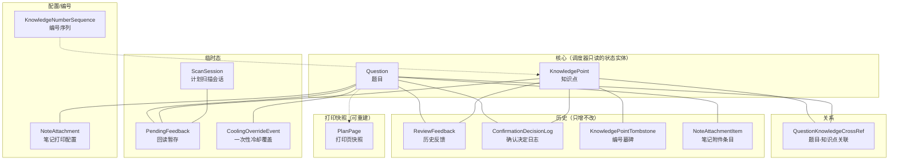

# 架构总览（数据结构）

> 口径：本文件按 `docs/specs/` 的规范口径编写。截至 2026-11-13，Gradle 骨架已建立，但 `app/`、`core/`、`data/`、`feature/` 下仍没有业务 Kotlin 源文件（见 `docs/conflicts.md` C-032，部分落地），无法做代码级字段核对；实现落地后必须按代码复核。
> 范围：只讲数据结构、字段产权与生命周期，不重复调度/打印算法细节。

## 1. 字段产权表

### KnowledgePoint

| 字段 | 类别 | 谁写 | 谁读 |
|---|---|---|---|
| id | 标识 | 录入 Repository | 所有层、外键 |
| number | 标识 | KnowledgeNumberSequence / Repository | 打印/扫描行序、墓碑 |
| name | 展示 | 录入 | 打印、确认页 |
| currentTier | 状态 | ApplyFeedbackUseCase | Scheduler、UseCase |
| continuousScore | 状态 | ApplyFeedbackUseCase | Scheduler、UseCase |
| effectiveFeedbackCount | 状态 | ApplyFeedbackUseCase | UseCase（冷启动/切换） |
| nextDueDate | 状态 | ApplyFeedbackUseCase / ApplyPlanDeferralsUseCase | Scheduler |
| activeQuestionCount | 状态 | Repository / 归档 UseCase | Scheduler、打印 |
| dormant | 状态 | Repository / UseCase | Scheduler、打印 |
| difficulty | 状态 | ApplyFeedbackUseCase（第 3 条 triggered 反馈后初始化/更新） | UseCase（DHP） |
| halfLifeDays | 状态 | ApplyFeedbackUseCase（第 3 条 triggered 反馈后初始化/更新） | UseCase（DHP） |
| createdAt | 审计（兼状态输入） | 录入 | UseCase（DHP 首段间隔）、审计 |

### Question

| 字段 | 类别 | 谁写 | 谁读 |
|---|---|---|---|
| id | 标识 | 录入 | 所有层 |
| pageId | 快照 | 打印层（打印成功后） | 确认页、手动回退、备份 |
| questionNumber | 展示 | 录入 | 打印、确认页、手动回退 |
| qrPayload | 快照 | 打印层（打印成功后） | Scan、备份 |
| archived | 状态 | 录入 / 归档 UseCase | Scheduler |
| lastScheduledDate | 状态 | 规划层（写为目标日） | 审计/展示 |
| lastReviewedDate | 状态 | ApplyFeedbackUseCase | Scheduler（冷却判定） |
| estimatedReviewMinutes | 状态 | 录入 | Scheduler（时间装箱） |
| createdAt | 审计 | 录入 | 审计、备份 |
| archivedAt | 审计 | 归档 UseCase | 审计、备份 |

> 只有标“状态”的字段参与调度；其余是标识、展示、审计或快照。注：`effectiveFeedbackCount`、`difficulty`、`halfLifeDays` 仅状态更新 UseCase 读取；本地无业务 Kotlin 代码见 C-032。
> `continuousScore` 持久化 `Float`；`ApplyFeedbackUseCase` 内部用 `Double` 计算，写入 Room / 构造 Scheduler DTO 时转 `Float`（C-050）。

## 2. 图 1：核心实体与附属表

> 调度器只读“核心”组里的状态字段；历史、临时态、快照不参与调度决策。
> 与旧版差异：新增 `ConfirmationDecisionLog`、`NoteAttachmentItem`、`KnowledgePointTombstone`、`KnowledgeNumberSequence`、`CoolingOverrideEvent`、`ScanSession`；`KnowledgePoint` 增加 `difficulty/halfLifeDays/createdAt`；`Question` 增加 `lastReviewedDate` 并删除 `coolingPeriodOverrideDays`；`PendingFeedback` 改复合主键并增加 `planId/pageId/plannedDate`；`ReviewFeedback`/`ConfirmationDecisionLog` 增加 `planId/pageId/plannedDate/reviewedOn`；`PlanPage` 增加 `knowledgeRows`。按实际实体为六组（核心/关系/历史/临时态/打印快照/配置编号）；题面列出的五类之外增加了“配置/编号”组。

## 3. 生命周期表

| 阶段 | 读什么 | 写什么 | 字段变化 |
|---|---|---|---|
| 录入 | 表单、已有知识点/题目 | KnowledgePoint、Question、CrossRef、NoteAttachmentItem | 分配 `number`；写入初始 tier/score/count/nextDueDate/activeQuestionCount/dormant；题目写入 `estimatedReviewMinutes` |
| 规划 | KnowledgePoint 状态、Question 状态、未消费 CoolingOverrideEvent、CrossRef、每日分钟 | PlanResult、PlanPage（pageId/pageNumber/date/questionIds/knowledgeRows/markers）、Question.lastScheduledDate | 冷却顺延 `nextDueDate` +1；`lastScheduledDate = targetDate`；命中 `coolingOverrides` 的题目跳过冷却 |
| 打印 | PlanPage、RenderableQuestion、NoteAttachmentItem | PDF、evidence、Question.pageId/qrPayload | 打印成功后写最近一次 pageId/QR；不改调度状态 |
| 回读 | 打印稿图像 | ScanSession、PendingFeedback | `planId/pageId/plannedDate`；`detectedTier/detectionStatus/conflict/detectedRawOcr`；`userDecision=UNMARKED` |
| 确认 | ScanSession、PendingFeedback、归属校验结果 | ReviewFeedback（**只此一次**）、ConfirmationDecisionLog、KnowledgePoint 状态、Question.lastReviewedDate、CoolingOverrideEvent（如点「本次提前复习」）；删除 PendingFeedback | 触发行全量更新 tier/score/count/nextDueDate/difficulty/halfLifeDays；非触发行只改 score ×0.3；`NOT_REVIEWED` 不写 ReviewFeedback、不改状态；`lastReviewedDate=actualReviewDate` |
| 再规划 | 更新后的 KnowledgePoint/Question | 新 PlanPage、DeferredItem | 依据新 `nextDueDate` 与 `lastScheduledDate` 重排；冷却期继续顺延 |

> `ReviewFeedback` 只在“确认”阶段写一次，之后不被调度读取；调度只读 KnowledgePoint/Question 的状态字段。

## 4. 同一概念的多形态表

| 层 | 形态（类名） | 只保留哪些字段 | 为什么这么设计 |
|---|---|---|---|
| Room | KnowledgePoint | 全部 12 个字段 | 全集：状态、展示、标识、审计都落库 |
| Scheduler | KnowledgeState | id、number、currentTier、continuousScore、nextDueDate、effectiveFeedbackCount、dormant、activeQuestionCount、difficulty、halfLifeDays、createdAt | 纯 Kotlin；去掉 name 等展示字段 |
| Room | Question | 全部 10 个字段 | 全集：含打印快照与审计 |
| Scheduler | SchedulerQuestion | id、linkedKnowledgeIds、archived、lastReviewedDate、estimatedReviewMinutes | 只保留排程所需；去掉 pageId/qrPayload/时间戳；`linkedKnowledgeIds` 由 data/room 从 cross-ref 映射（C-046） |
| Pagination | RenderableQuestion（由 Room 的 Question/KnowledgePoint/NoteAttachmentItem 投影） | questionId、questionNumber、knowledgeCount、knowledgeNames、knowledgeLineCount、attachmentCount、hasNoteArea | 打印投影；不含任何调度状态 |
| Pagination / Print | PlannedPage / PlacedItem / ContinuationMarker | 页、位置、高度、续下页顺序 | Print 只消费映射，不自行分页（R-02） |
| Pagination | `PaginationResult.Success` / `PaginationResult.Failure` | Success：pages/overflowItems/warnings；Failure：code/message | 分页失败不混入 pages/warnings（C-047） |
| Planning | PlanDraft / PrintJob | PlanDraft：planId/pages/scheduledDates/coolingEventIds/deferred；PrintJob：planId/pages/questions/notes/template | 编排层持久化与打印输入；不进入调度 |
| Room | PendingFeedback → ConfirmedDecision（UseCase）→ ReviewFeedback | 逐行决策字段；ReviewFeedback 保留 tier/triggered/OCR/权重/时间 | 临时态只活到确认；历史只增不改 |

> Room 是全集，其余是子集；转换函数在 `data/room`，`core/model` 只放纯 DTO/枚举与 `KnowledgeRowsCodec`（C-046 方案 A）；Print 消费 `PrintJob`，Confirm 消费 `PendingFeedback`/`ConfirmedDecision`，不自行查库分页。

## 5. 最小状态集

- **每个知识点 10 个**：`id`、`currentTier`、`continuousScore`、`nextDueDate`、`dormant`、`activeQuestionCount`（以上 `plan()` 读取）+ `effectiveFeedbackCount`、`difficulty`、`halfLifeDays`、`createdAt`（仅状态更新 UseCase 读取，不参与候选/装箱）。
- **每个题目 5 个**：`id`、`linkedKnowledgeIds`、`archived`、`lastReviewedDate`、`estimatedReviewMinutes`。

其余字段不影响下一周计划：`number`/`name` 服务行序与展示；`pageId`/`qrPayload` 是打印快照；`lastScheduledDate` 是计划日审计/展示；`createdAt`/`archivedAt` 是审计；`ReviewFeedback`、`ConfirmationDecisionLog`、`PlanPage`、`PendingFeedback`、`ScanSession` 不被调度读取；`CoolingOverrideEvent` 只影响冷却判定，不参与候选排序/装箱。

## 6. 自测三问

**问 1：非触发知识点在确认后哪些字段会变？**
答：只有 `continuousScore` 按该行自身档位的 D-03 增量 ×0.3 变化；`currentTier`、`nextDueDate`、`effectiveFeedbackCount` 都不变。写一条 `ReviewFeedback(triggered=false, weightApplied=0.3)` 和一条 `ConfirmationDecisionLog`；不推进冷启动阶梯。

**问 2：`ReviewFeedback` 会被调度器读取吗？**
答：不会。调度器只读 KnowledgePoint/Question 的状态字段；`ReviewFeedback` 只在确认阶段写一次，之后只服务审计、备份和笔记来源。`effectiveFeedbackCount`/`difficulty`/`halfLifeDays` 存在 KnowledgePoint 上，供状态更新 UseCase 使用，不靠读 ReviewFeedback 表。

**问 3：删除可重建快照会影响规划吗？**
答：不会影响 `plan()`。`PlanPage`/`knowledgeRows` 是打印快照，删除后下次打印可重建；但已打印旧稿的回读、手动回退会失效，需要重印。`PendingFeedback` 删除只影响未完成确认，不影响规划；清空 `Question.pageId/qrPayload` 只影响回读，不影响调度。
